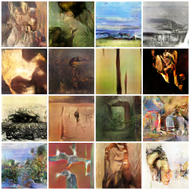
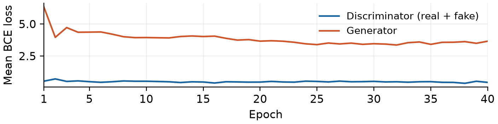

# ECE 285 Homework 2: Painting Generation with GANs

A PyTorch implementation of generative adversarial networks for generating
64 × 64 RGB paintings from the assigned
[WikiArt dataset](https://www.kaggle.com/datasets/steubk/wikiart). The project
includes data preprocessing, GAN training, generated paintings, loss curves,
and Inception Score (IS) and Fréchet Inception Distance (FID) evaluation using
PyTorch-Ignite.

[Report (two pages, NeurIPS format)](report.pdf) ·
[Model implementation](nautilus/payload/models.py) ·
[Training code](nautilus/payload/train.py) ·
[Evaluation code](nautilus/payload/evaluate.py)

## Method and data

The generator maps 100-dimensional Gaussian noise to an RGB image through
transposed convolutions, batch normalization, ReLU, and a final Tanh. The
DCGAN discriminator produces one logit per image. Training alternates a
real/fake BCE discriminator update and a non-saturating generator update.
A second configuration uses resize-convolution, spectral normalization, and
hinge losses.

Images are EXIF-corrected, converted to RGB, center-cropped, and resized
bicubically. Exact processed-pixel deduplication retains 80,697 of 81,444
candidate images across 27 styles. A seeded content hash assigns 64,615
training, 7,965 validation, and 8,117 test images. Style labels are not used
for training. Near duplicates and shared artists may remain across splits.

## Results

| Model (base width / epochs) | Validation FID-2048 ↓ | Validation IS ↑ | Test FID-2048 ↓ | Test IS ↑ |
| --- | ---: | ---: | ---: | ---: |
| DCGAN baseline (32 / 20) | 112.81 | 3.212 | 111.84 | 3.213 |
| DCGAN (64 / 40) | **67.62** | 4.402 | **67.58** | **4.402** |
| Resize + spectral normalization + hinge (64 / 40) | 75.77 | 4.713 | — | — |

Model configuration selection uses validation FID at the final epoch of each
declared training budget. The width-64 DCGAN is then evaluated on held-out
test images. Each evaluation uses 5,000 generated and 5,000 real images.
FID-2048 uses `pytorch-fid` pool3 features, while IS uses ImageNet class
probabilities. IS is computed as one aggregate, without split-based standard
deviations. Validation and test reuse the same generated samples; their IS
values therefore agree to rounding. The baseline test evaluation uses MPS;
validation comparisons and the width-64 test evaluation use CUDA.

The width-64 DCGAN uses batch size 128, Adam learning rate 0.0002,
Adam betas (0.5, 0.999), and training seed 285. Evaluation uses real-image
selection seed 286 and latent seed 1286. Its test FID is 39.6% lower than the
baseline. Width and training duration change together, so their contributions
are not isolated. These are single-seed experiments; 64 × 64 resolution and
ImageNet-based metrics limit conclusions about fine detail and artistic fidelity.

### Generated paintings

First 16 seeded test samples from the width-64 DCGAN:



### Training losses

Epoch-mean BCE losses for the width-64 DCGAN. The discriminator loss sums
real and fake BCE terms. Loss values alone do not establish convergence.



The loss curve is also included in [Figure 1 of the report](report.pdf).

## Code organization

| Path | Purpose |
| --- | --- |
| `prepare_data.py`, `data.py` | Image preprocessing, deduplication, partitioning, and cached loading |
| `nautilus/payload/models.py` | DCGAN and resize-convolution architectures and adversarial updates |
| `nautilus/payload/train.py` | GPU training, seeded sampling, checkpoints, and epoch histories |
| `nautilus/payload/evaluate.py` | Held-out FID and IS evaluation |
| `generate.py` | Standalone generation with the plain DCGAN checkpoints |
| `audit_data.py`, `audit_results.py` | Dataset and metric consistency checks |
| `plot_results.py` | Loss curves from recorded epoch means |
| `report_nautilus/` | LaTeX report source, measured values, and figures |
| `results/` | Configurations, histories, generator weights, metrics, and sample grids |

Root-level `models.py`, `train.py`, and `evaluate.py` are the baseline
implementation. The GPU comparison uses `nautilus/payload/`, which supports
both architecture variants. The selected plain DCGAN checkpoint can also be
loaded by the root-level generation script.

## Setup and sample generation

Use Python 3.12 and run commands from the repository root:

```bash
python -m venv .venv
source .venv/bin/activate
python -m pip install -r requirements.txt
python generate.py --checkpoint results/nautilus-v1/plain/generator_040.pt --device cpu --samples 16 --columns 4 --output wider_dcgan.png
```

Generation requires no dataset download. The recorded GPU runs used PyTorch
2.4.1+cu121, torchvision 0.19.1, NumPy 1.26.4, and an A100 80 GB;
`requirements.txt` records the local environment. See
[the GPU environment notes](nautilus/README.md) for the pinned container.

## Reproduce training and evaluation

Download version 1 of the assigned WikiArt archive, save it as
`wikiart-v1.zip`, and prepare a new cache:

```bash
python prepare_data.py --archive wikiart-v1.zip --output data/wikiart64_rerun
python audit_data.py --data data/wikiart64_rerun
cmp data/wikiart64/manifest.csv data/wikiart64_rerun/manifest.csv
```

Train the two width-64 configurations in separate output directories:

```bash
python nautilus/payload/train.py --data data/wikiart64_rerun --output results/rerun_plain --device cuda --variant plain --width 64 --epochs 40
python nautilus/payload/train.py --data data/wikiart64_rerun --output results/rerun_resize --device cuda --variant resize-sn --width 64 --epochs 40
```

Evaluate each configuration on validation data before selecting by FID:

```bash
python nautilus/payload/evaluate.py --data data/wikiart64_rerun --checkpoint results/rerun_plain/generator_040.pt --output results/rerun_plain_validation --split validation --device cuda
python nautilus/payload/evaluate.py --data data/wikiart64_rerun --checkpoint results/rerun_resize/generator_040.pt --output results/rerun_resize_validation --split validation --device cuda
```

For the recorded selected configuration, the test and independent audit commands are:

```bash
python nautilus/payload/evaluate.py --data data/wikiart64_rerun --checkpoint results/nautilus-v1/plain/generator_040.pt --output results/recheck_test --split test --device cuda
python audit_results.py --evaluation results/recheck_test --checkpoint results/nautilus-v1/plain/generator_040.pt
python plot_results.py --run results/rerun_plain
```

The audit recomputes metrics from the feature arrays produced by evaluation.
Historical audit records are included; the large historical feature arrays,
raw image cache, and optimizer states are not stored in this repository.
The dataset manifest and checkpoint hashes identify the recorded inputs.
`nautilus/inputs.original.sha256` records the experiment's original checksums;
`nautilus/inputs.sha256` records the annotated experiment source.

## References

- [Assigned WikiArt dataset](https://www.kaggle.com/datasets/steubk/wikiart)
- [DCGAN paper](https://arxiv.org/abs/1511.06434)
- [PyTorch-Ignite FID and IS tutorial](https://pytorch-ignite.ai/blog/gan-evaluation-with-fid-and-is/)
- [pytorch-fid feature extractor](https://github.com/mseitzer/pytorch-fid)
